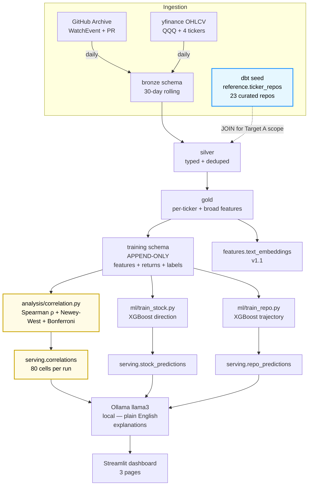

# quack-flow

**A zero-cost pipeline that tests whether GitHub developer activity predicts tech stock movements — and explains every correlation in plain English, honestly.**

Target audience: skeptical data-engineering and quant-adjacent readers who care more about methodology than about whether the signal is real.

---

## The claim this project makes

Most "ML portfolio" projects pitch model accuracy. This one pitches **methodology**.

The core hypothesis — that GitHub commit velocity, star growth, and PR activity lead tech stock movements at short horizons — is almost certainly weak or null at the sample sizes the pipeline can reach in its first months of running. That is **not a bug**. That is the design.

Every correlation on the dashboard shows:

- Spearman ρ, not Pearson — rank-based, robust to fat-tailed returns.
- Newey-West HAC–adjusted p-values — because daily returns are autocorrelated and rolling 7-day features induce dependence Pearson silently ignores.
- Bonferroni correction across **80 tested hypotheses** (4 GitHub signals × 5 tickers × 4 lags) — α = 0.05 / 80 ≈ 0.000625 per cell.
- The minimum detectable effect at current sample size — so a reader sees immediately what the test can and cannot detect today.
- A permanent banner stating *"to detect |ρ| = 0.3 at 80% power, we need N more days of pipeline runs."*

If no signal shows up, that matches the power analysis and it says so, up front. If a signal does show up after the pipeline accumulates enough data, it survives scrutiny that most "I found alpha" portfolio projects do not.

The receipt is the rigor. The pipeline is the medium.

---

## Power analysis (up front, because it defines what this project can claim)

Bonferroni-adjusted α = 0.000625. Minimum detectable |ρ| computed via the Fisher-z transform:

| n (observations) | Min detectable \|ρ\| at 80% power | When this is reached |
|---|---|---|
| 16 | ≈ 0.83 | Day 1, longest lag (T+14) post-backfill |
| 30 | ≈ 0.68 | Day 1, shortest lag (T+1) post-backfill |
| 60 | ≈ 0.51 | ~30 daily runs in |
| 90 | ≈ 0.42 | ~60 daily runs in (v1.1 power-up checkpoint) |
| 250 | ≈ 0.27 | ~8 months of daily runs |

**Read this table honestly.** No public signal about stock movements should survive |ρ| > 0.5 after correction — if it did, the market would already know. So the expected null for the first 30+ days of runtime is **"no cell clears Bonferroni."** The dashboard will show this plainly. That's the point.

The math:

```
min |ρ| ≈ tanh( (z_α/2 + z_1-β) / √(n − 3) )
where  z_α/2 = Φ⁻¹(1 − 0.000625/2) ≈ 3.42
       z_1-β = Φ⁻¹(0.80) ≈ 0.84
```

---

## What quack-flow does

1. **Ingests** GitHub Archive events (`WatchEvent` + `PullRequestEvent`) with two parallel scopes — a **curated per-ticker repo set** (23 repos total; see the mapping table below) that feeds the stock-direction hypothesis, and a broader ≥5-events/day filter that feeds the repo-trajectory model. Plus Yahoo Finance OHLCV for `QQQ`, `AAPL`, `MSFT`, `GOOGL`, `META`. Rolling 30-day window in Bronze, drop-and-reload daily.
2. **Persists** a parallel append-only `training` schema with feature snapshots + continuous forward returns + binary labels — so the nightly rolling-window reload doesn't wipe training data.
3. **Aligns** both signals on a shared time axis through a Bronze → Silver → Gold dbt medallion.
4. **Measures** Spearman ρ between each *per-ticker* GitHub signal (aggregated over that ticker's curated repo set) and that ticker's daily log return at lags T+1, T+3, T+7, T+14, with Newey-West HAC standard errors and Bonferroni correction.
5. **Predicts** two targets as supporting evidence:
   - **Stock direction** — will this ticker close higher in 7 days? (XGBoost, GitHub features + price controls.)
   - **Repo trajectory** — will this repo 2× its stars in 14 days? (XGBoost, GitHub features only.)
6. **Explains** every prediction and every heatmap in plain English — Ollama (llama3, local) + SHAP top-3 feature attribution.
7. **Shows** it on a 3-page Streamlit dashboard: correlation heatmap, stock predictions, repo predictions. Every cell shows n and whether it cleared Bonferroni.

---

## The ticker → repos mapping

The hypothesis "does GitHub activity predict stock moves?" is untestable until you name *which* GitHub activity. This mapping is what makes the correlation claim falsifiable — a skeptical reader can argue with the choices below, which is exactly the kind of engagement this project wants.

| Ticker | Repos | Role |
|---|---|---|
| **MSFT** | `microsoft/vscode`, `microsoft/TypeScript`, `microsoft/onnxruntime`, `microsoft/semantic-kernel` | owned |
| **GOOGL** | `tensorflow/tensorflow`, `google/jax`, `google/gemma`, `golang/go` | owned |
| **META** | `facebook/react`, `pytorch/pytorch`, `meta-llama/llama`, `facebookresearch/faiss` | owned |
| **NVDA** | `NVIDIA/TensorRT`, `NVIDIA/NeMo`, `NVIDIA/cuda-python` | owned |
| **AAPL** | `apple/swift`, `WebKit/WebKit`, `apple/ml-stable-diffusion` | owned |
| **QQQ** | `huggingface/transformers`, `vercel/next.js`, `langchain-ai/langchain`, `apache/spark`, `moby/moby` | ecosystem |

**23 repos total, 5 tickers + 1 index proxy.** The authoritative source is [`dbt_project/seeds/ticker_repos.csv`](dbt_project/seeds/ticker_repos.csv) — each row has a short `rationale` column explaining why that repo was chosen for that ticker. Edit the CSV and run `dbt seed` to change the mapping; never hardcode it in Python or SQL.

**Known v1 limitation — NVDA.** NVIDIA is unusual because a lot of the relevant signal lives in *who* contributes to repos NVIDIA doesn't own (`pytorch/pytorch`, `openai/triton`). Building that requires reliable author→employer mapping from commit metadata, which public GitHub Archive events often don't surface cleanly. v1 scopes NVDA to owned repos only. Contributor-level signal is a documented v1.1 extension.

---

## Architecture



The yellow path is the hero — correlation analysis writes into `serving.correlations`, which powers the dashboard's heatmap. Everything else supports it.

---

## Cost breakdown

| Component | Provider | Cost |
|---|---|---|
| Local compute | User's laptop | $0 |
| Orchestration | Airflow (docker-compose, local) | $0 |
| Scheduler | macOS `launchd` | $0 |
| Local OLAP | DuckDB | $0 |
| Cloud OLAP | MotherDuck (free tier, ≤10 GB) | $0 |
| ML libraries | scikit-learn, XGBoost, SHAP, sentence-transformers | $0 |
| Experiment tracking | MLflow (local file store) | $0 |
| LLM | Ollama + llama3 (local, CPU or Apple Silicon) | $0 |
| Dashboard | Streamlit Cloud (free tier) | $0 |
| Source hosting | GitHub (public repo) | $0 |
| Data sources | GitHub Archive (gharchive.org), yfinance | $0 |
| **Total recurring** | | **$0 / month** |

Zero-cost isn't a constraint — it's the thesis. Every choice above was made to defend that row.

---

## Stack

| Tool | Purpose |
|---|---|
| Python 3.11 + `uv` | Runtime + package manager (lockfile-backed, reproducible) |
| DuckDB 1.2+ | Local OLAP engine + VSS extension for embeddings |
| MotherDuck | Cloud DuckDB (prod only, free tier) |
| Apache Airflow 2.10 | DAG orchestration (Docker-composed locally) |
| dbt-duckdb 1.8+ | SQL transformation layer (silver → gold) |
| XGBoost 2.0+ | Tabular classifier for both targets |
| sentence-transformers 3.0+ | Text → 384-dim embeddings (v1.1) |
| SHAP 0.45+ | Per-prediction feature attribution |
| `scipy` + `statsmodels` | Fisher-z, Spearman ranks, Newey-West HAC errors |
| MLflow 2.12+ | Experiment tracking + model registry |
| Ollama + llama3 | Local LLM explanation layer |
| Streamlit 1.35+ | Dashboard (read-only against MotherDuck) |

---

## Deviations from the initial spec

Documented as first-class decisions, not silent drift.

| Earlier spec | What we actually build | Reason |
|---|---|---|
| GitHub Actions REST trigger | `launchd` CRON on laptop at 07:00 | GitHub Actions needs a public Airflow endpoint — breaks the zero-cost thesis |
| NYC Open Data as third source | Dropped | No defensible join to stock or repo prediction |
| 90-day repo prediction horizon | 14-day binary label | 90-day lag conflicts with the 30-day rolling window |
| Stacking meta-learner | XGBoost-only for v1 (stacking → v1.1) | One weekend of work on its own once VSS features are live |
| Single `serving.predictions` table | Two tables: `serving.stock_predictions` + `serving.repo_predictions` | Clean schema per target |
| Pearson r for correlation | Spearman ρ + Newey-West HAC + Bonferroni | Pearson violates i.i.d. on autocorrelated returns with overlapping-window predictors |
| All 6 stock features as hypotheses | 4 GitHub signals only (price features are controls) | `ohlcv_momentum_7d` and `volume_spike` are controls, not the GitHub→stock hypothesis |

---

## Running locally

Prerequisites: macOS or Linux, Docker, [uv](https://github.com/astral-sh/uv), and [Ollama](https://ollama.com/).

```bash
# clone and enter
git clone https://github.com/MarksonMarcolino/quack-flow.git
cd quack-flow

# install Python 3.11 + all deps (lockfile-backed)
uv sync

# pull the LLM used for explanations (~4 GB, one-time)
ollama pull llama3

# copy the env template and fill in your MotherDuck token
cp .env.example .env
# edit .env — set MOTHERDUCK_TOKEN if you want prod runs

# verify Ollama is wired up
uv run python scripts/ollama_hello.py

# later (weekend 2+): bring up Airflow
docker-compose up -d
open http://localhost:8080   # airflow / airflow
```

---

## Ollama integration sanity check (verified)

Output of `uv run python scripts/ollama_hello.py` from a real run on this machine:

```
============================================================
quack-flow Ollama hello-world  (llama3 @ http://localhost:11434)
============================================================

INPUT (fake SHAP context):
{
  "ticker": "MSFT",
  "prediction": "UP in 7 days",
  "confidence": 0.61,
  "top_features": [
    ["commit_velocity_7d_python_repos", 0.18],
    ["star_growth_7d_ai_tagged", 0.11],
    ["pr_merge_rate_7d_azure_repos", -0.07]
  ]
}

OUTPUT (llama3):
Our model is predicting that Microsoft's stock (MSFT) will increase within
the next 7 days, based on a combination of GitHub activity metrics from
the past week. The top features driving this prediction are commit
velocity in Python repositories, star growth in AI-tagged projects, and
pull request merge rate in Azure-repos. While these correlations may be
intriguing, it's essential to note that we're not suggesting that these
GitHub metrics directly cause stock price movements – we're simply
observing associations.

Caveat: This prediction does NOT imply that Microsoft's actual financial
performance or market forces are directly influenced by...

============================================================
Integration sanity check: PASS
============================================================
```

*(Output truncated because `num_predict=120` per CLAUDE.md's prompt budget — that's a deliberate cost choice, not a bug.)*

The full verbatim output lives in [`scripts/ollama_hello_output.txt`](scripts/ollama_hello_output.txt).

---

## Try it live

Coming weekend 9 — Streamlit Cloud URL will land here.

---

## Build plan

Full 10-weekend schedule with parachute milestones per weekend lives in the project's internal design doc. Headlines:

- **Weekends 1-4** — scaffold, ingestion, dbt silver/gold, training-schema backfill
- **Weekend 5** — correlation analysis + power-analysis README section (the hero weekend)
- **Weekends 6-7** — XGBoost models + SHAP + Ollama explanations
- **Weekends 8-10** — Streamlit dashboard + deploy + README polish

Every weekend ends with a `git push origin main`. No long-lived feature branches. Progress is public by design.

---

## License

MIT. This is a portfolio artifact — take whatever's useful.
